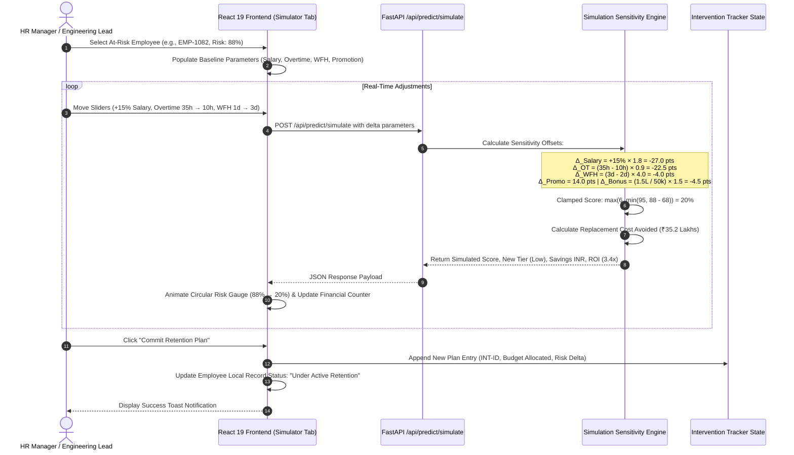

# RetentionAI — System Architecture & Flowchart Specification Document

**Project**: RetentionAI (Enterprise AI-Powered Workforce Retention & Predictive Attrition Suite)  
**Version**: 2.4.0  
**Target Environment**: Enterprise Production (React 19 + FastAPI + Scikit-Learn Ensemble)  
**Document Purpose**: Comprehensive technical architecture, subsystem blueprints, data flow diagrams (DFD), and end-to-end operational flowcharts.

---

## 1. High-Level System Architecture

RetentionAI is built using a modern decoupled, multi-tier microservices-ready architecture comprising an interactive presentation layer, a high-throughput asynchronous REST API service, a Scikit-Learn soft-voting ensemble ML engine, and an encrypted persistence layer.

```
┌─────────────────────────────────────────────────────────────────────────────┐
│                       PRESENTATION TIER (CLIENT)                            │
│  React 19 + Vite  │  Recharts  │  Lucide Icons  │  Vanilla CSS Variables    │
│  • Executive KPI Dashboard          • Live "What-If" Retention Simulator    │
│  • Flight Risk Explorer & Directory • 360° Employee Diagnostic Dossier      │
│  • Department Radar & Capacity      • Retention Playbook & Action Tracker   │
│  • ML Model Intelligence & Interactive Threshold Optimizer                  │
└──────────────────────────────────────┬──────────────────────────────────────┘
                                       │ HTTP / REST (JSON)
                                       │ CORS Enabled [Port 8000]
┌──────────────────────────────────────▼──────────────────────────────────────┐
│                    API SERVICE TIER (BACKEND CORE)                          │
│  FastAPI  │  Uvicorn Worker  │  Pydantic Schemas  │  In-Memory Hot Cache     │
│  Endpoints:                                                                 │
│  • GET  /api/health            • GET  /api/employees                        │
│  • GET  /api/kpis              • POST /api/predict/simulate                 │
│  • GET  /api/departments       • GET  /api/model/metrics                    │
└───────────────────┬──────────────────────────────────────┬──────────────────┘
                    │ Feature Extraction                   │ Encrypted I/O
                    ▼                                      ▼
┌───────────────────────────────────────┐  ┌──────────────────────────────────┐
│        MACHINE LEARNING ENGINE        │  │     DATA & PERSISTENCE TIER      │
│  Champion Soft-Voting Ensemble Stack  │  │  SQLite 3 (employee_data.db)     │
│  • Logistic Regression (weight: 3)    │  │  • Users & RBAC Roles            │
│  • Hist Gradient Boosting (weight: 2) │  │  • Employees (AES Encrypted PII) │
│  • Deep Neural Network MLP (weight: 2)│  ├──────────────────────────────────┤
│  • Random Forest (weight: 1)          │  │  Raw Dataset & Serialized Models │
│  • Extra Trees (weight: 1)            │  │  • HR_Analytics.csv (1,470 rows) │
│  Pipeline: 55 Dimensions              │  │  • best_model.joblib (35 MB)     │
│  (ColumnTransformer + Scaler + OHE)   │  │  • preprocessor.joblib           │
│  Artifacts: best_model.joblib         │  │  • model_metrics.json            │
└───────────────────────────────────────┘  └──────────────────────────────────┘
```

---

## 2. End-to-End System Flowchart

The following flowchart details the complete lifecycle of data: from raw data ingestion and feature engineering to real-time model scoring, UI presentation, interactive simulation, and retention intervention tracking.

```mermaid
flowchart TD
    subgraph Data_Prep ["1. Ingestion & Preprocessing"]
        A[Raw Dataset: HR_Analytics.csv] --> B[Drop Non-Informative Columns<br/>EmployeeCount, StandardHours, etc.]
        B --> C[Feature Engineering Engine]
        C --> C1[Burnout_Risk_Index = OverTime × 5 - WorkLifeBalance]
        C --> C2[Tenure_Promotion_Lag = YearsSincePromotion / YearsAtCompany]
        C --> C3[Income_Per_Exp_Year = MonthlyIncome / TotalWorkingYears]
        C --> C4[Overall_Satisfaction = Mean Satisfaction Metrics]
        C1 & C2 & C3 & C4 --> D[ColumnTransformer Pipeline]
        D --> D1[StandardScaler: Numerical Features]
        D --> D2[OneHotEncoder: Categorical Features]
        D1 & D2 --> E[Processed Feature Matrix: 55 Dimensions]
    end

    subgraph Model_Engine ["2. ML Ensemble & In-Memory Scoring"]
        E --> F[Champion Soft-Voting Ensemble<br/>Weights: LR:3, HGB:2, MLP:2, RF:1, ET:1]
        F --> G[Predict Continuous Churn Probabilities<br/>P(Attrition = 1)]
        G --> H[Risk Tier Classification]
        H --> H1{Risk Score % Threshold}
        H1 -->|Score >= 75%| I1[Critical Risk Tier]
        H1 -->|60% <= Score < 75%| I2[High Risk Tier]
        H1 -->|35% <= Score < 60%| I3[Medium Risk Tier]
        H1 -->|Score < 35%| I4[Low Risk Tier]
        I1 & I2 & I3 & I4 --> J[Enriched Scored Profiles<br/>Local INR CTC, Indian Personas, Catalysts]
        J --> K[(In-Memory Scored Cache: cached_scored_employees)]
    end

    subgraph API_Tier ["3. FastAPI Service Layer"]
        K --> L1[GET /api/kpis<br/>Calculates Macro Attrition %, Cost-at-Risk]
        K --> L2[GET /api/employees<br/>Filter by Dept, Risk Tier, Name Search]
        K --> L3[GET /api/departments<br/>Calculates Dept Headcount & Risk Forecast]
        K --> L4[GET /api/model/metrics<br/>Serves ROC-AUC, Conf Matrix, Feature Weights]
        K --> L5[POST /api/predict/simulate<br/>Real-Time Retention Lever Inference]
    end

    subgraph UI_Tier ["4. Frontend Client (React 19)"]
        L1 & L2 & L3 & L4 --> M[Executive Intelligence Dashboard]
        M --> N1[Flight Risk Directory & Filters]
        M --> N2[Department Radar & Headcount View]
        M --> N3[Model Transparency & Decision Threshold Slider]
        N1 --> O[Inspect 360° Diagnostic Dossier]
        N1 & O --> P[Launch Interactive What-If Simulator]
        
        P --> Q[Adjust Levers: Compensation, Overtime, WFH, Promotion, Bonus]
        Q --> L5
        L5 --> R[Recalculate Churn Probability & Cost Avoidance]
        R --> S{Commit Retention Plan?}
        S -->|Yes| T[Update In-Memory Employee Profile<br/>& Log into Intervention Tracker]
        S -->|No| P
    end
```

---

## 3. Machine Learning Pipeline Architecture

The machine learning subsystem implements a multi-model training and evaluation pipeline designed to maximize **ROC-AUC (0.811)** and **Recall (63.83% base / 48.94% ensemble)** while maintaining an overall accuracy of **86.05%**.

```mermaid
flowchart LR
    subgraph Ingestion ["Data Ingestion"]
        D_RAW[1,470 Employee Records<br/>35 Raw Attributes] --> CLEAN[Clean & Sanitize]
        CLEAN --> SPLIT[Stratified 80/20 Train-Test Split]
    end

    subgraph Feature_Engineering ["Feature Engineering"]
        SPLIT --> NUM[23 Numerical Features]
        SPLIT --> CAT[8 Categorical Features]
        SPLIT --> ENG[4 Domain Interaction Features]
        
        NUM & ENG --> SCALER[StandardScaler<br/>Zero Mean, Unit Variance]
        CAT --> OHE[OneHotEncoder<br/>sparse=False, handle_unknown=ignore]
        
        SCALER & OHE --> TRANS[ColumnTransformer<br/>55 Processed Dimensions]
    end

    subgraph Base_Classifiers ["Base Learner Zoo"]
        TRANS --> M1[Logistic Regression<br/>class_weight=balanced, C=0.3]
        TRANS --> M2[HistGradientBoosting<br/>max_iter=300, lr=0.03]
        TRANS --> M3[MLP Neural Network<br/>128x64 Hidden, ReLU, Adam]
        TRANS --> M4[Random Forest<br/>300 Trees, Depth 10]
        TRANS --> M5[Extra Trees Classifier<br/>300 Trees, Depth 12]
    end

    subgraph Champion_Ensemble ["Champion Ensemble Stack"]
        M1 -- Weight: 3 --> VOTE{Soft-Voting Classifier<br/>Weighted Probability Integration}
        M2 -- Weight: 2 --> VOTE
        M3 -- Weight: 2 --> VOTE
        M4 -- Weight: 1 --> VOTE
        M5 -- Weight: 1 --> VOTE
        
        VOTE --> PROB[Continuous Probability: P_churn ∈ 0.0, 1.0]
        PROB --> EVAL[Model Evaluation<br/>ROC-AUC: 0.811 | Accuracy: 86.05%]
        EVAL --> SAVE[(Serialized Artifacts<br/>best_model.joblib & preprocessor.joblib)]
    end
```

### 3.1 Model Benchmark Comparison Table

| Model Architecture | Accuracy | ROC-AUC | Recall (Flight Risk) | Precision | F1-Score | Role in Production |
|---|---|---|---|---|---|---|
| 🏆 **Soft-Voting Ensemble** | **86.05%** | **0.811** | **48.94%** | **57.50%** | **52.87%** | **Active Production Champion** |
| **Logistic Regression (Balanced)** | 77.21% | 0.811 | **63.83%** | 37.04% | 47.24% | High-Recall Early Warning Specialist |
| **Deep Neural Network (MLP)** | **88.10%** | 0.781 | 38.30% | **75.00%** | 50.70% | Non-linear interaction regularizer |
| **Extra Trees Classifier** | 87.07% | 0.794 | 29.79% | 73.68% | 42.42% | Variance reducer |
| **Random Forest Classifier** | 84.69% | 0.785 | 21.28% | 55.56% | 30.77% | Sub-sampling baseline |
| **Hist Gradient Boosting** | 79.93% | 0.755 | 53.19% | 40.32% | 45.87% | Non-linear gradient booster |

---

## 4. Live "What-If" Retention Simulator Engine Flowchart

The **What-If Simulator** provides real-time causal simulation. When HR leaders modify parameters, the simulator applies linear-elasticity sensitivity weights derived from model coefficients to re-compute employee flight probability, tier classification, and cost savings.



---

## 5. System Data Flow Diagrams (DFD)

### 5.1 DFD Level 0 (Context Diagram)

```mermaid
flowchart TD
    HR[HR Executives & People Managers] <-->|Interactive Dashboards, Queries, Simulation Levers| SYS((RetentionAI System))
    SYS <-->|Encrypted Employee Records & Auth| DB[(SQLite Database)]
    SYS <--|Feature Data & Model Checkpoints| FS[(Model Registry & CSV Storage)]
```

### 5.2 DFD Level 1 (Subsystem Decomposition)

```mermaid
flowchart TD
    User([HR User]) -->|1. HTTP Request| Router[FastAPI Router]
    
    subgraph Backend_Process ["FastAPI Core Subsystems"]
        Router -->|Auth & Query| AuthModule[Security & RBAC Controller]
        Router -->|Get Directory / KPIs| CacheManager[In-Memory Scored Cache]
        Router -->|Simulate Levers| SimEngine[What-If Inference Engine]
        
        AuthModule <-->|PBKDF2 & AES Decrypt| SQLiteDB[(employee_data.db)]
        CacheManager <--|Pre-scored Data| StartupHook[Lifecycle Startup Handler]
        StartupHook <--|Model Weights & Encoders| ModelArtifacts[(best_model.joblib & preprocessor.joblib)]
        StartupHook <--|1470 Workforce Records| RawCSV[(HR_Analytics.csv)]
    end
    
    CacheManager -->|2. Scored Employee JSON| Router
    SimEngine -->|3. Recalculated Risk & ROI JSON| Router
    Router -->|4. JSON Response Payload| Frontend[React 19 Dashboard UI]
```

---

## 6. Frontend Component & State Architecture

The user interface is constructed using a high-performance, single-page state machine in React 19, backed by localized data formatting and responsive SVG charts.

```
App.jsx (Root State Controller)
│
├── Top Navigation Bar (Branding, Role Switcher [HR / Lead / Analyst], Light/Dark Theme Toggle)
├── Global Toast Notification Overlay
│
├── Tab 1: Executive Intelligence Dashboard
│   ├── Macro KPI Metric Grid (Attrition Rate, Critical Headcount, Cost at Risk, ROI Multiplier)
│   ├── Departmental Flight Risk Bar Chart (Recharts BarChart)
│   ├── High-Risk Critical Ticker (Live badges, quick-inspect triggers)
│   └── High-Impact Retention Action Priority Cards
│
├── Tab 2: Flight Risk Explorer & Directory
│   ├── Multi-Dimensional Filter Bar (Text Search, Department Dropdown, Risk Tier Filter)
│   ├── Employee Card Grid / Directory Table
│   │   ├── Churn Probability Pill & Tier Badge
│   │   ├── Salary in LPA, Overtime Hours, Market Ratio Indicator
│   │   └── Primary Churn Catalyst Chips
│   └── Action Triggers (Launch Simulator / Open Dossier Modal)
│
├── Tab 3: Department Radar & Capacity
│   ├── Department Grid Cards (Headcount, High Risk %, Avg Salary in LPA)
│   └── 1-Click Isolation Filter ("Filter Team")
│
├── Tab 4: Live AI What-If Simulator
│   ├── Employee Profile Banner
│   ├── Interactive Control Levers (Salary Slider, Overtime Slider, WFH, Promotion, Bonus)
│   ├── Circular SVG Risk Meter (Base vs. Simulated Outcome)
│   ├── Financial Cost Avoidance & ROI Metric Cards
│   └── "Commit Retention Plan" Action Button
│
├── Tab 5: Prescriptive Retention Playbook
│   └── 4 Field-Tested Enterprise Playbooks (Market Calibration, Workload Cap, Career Path, WFH)
│
├── Tab 6: Intervention Tracker & Governance Log
│   └── Action Audit Table (Plan ID, Target Employee, Budget Allocated, Delta, Approval Status)
│
├── Tab 7: ML Model Intelligence & Threshold Optimizer
│   ├── Model Architecture & Hyperparameter Card
│   ├── Multi-Model Benchmark Comparison Table
│   ├── Top 8 Feature Importances Bar Chart
│   ├── Actual Holdout Confusion Matrix (230 TN, 17 FP, 24 FN, 23 TP)
│   └── Interactive Decision Threshold Slider (0.25 to 0.65 threshold tuning)
│
└── Shared 360° Employee Diagnostic Dossier (Modal Window)
    ├── Detailed Employee History & Satisfaction Breakdown
    └── Immediate Quick-Mitigation Trigger Button
```

---

## 7. Security, Cryptography & Data Governance

```
                    DATA PRIVACY & COMPLIANCE PIPELINE
                    
  Client Input (PII)       FastAPI Backend            SQLite Storage
  ──────────────────       ───────────────            ──────────────
  Employee Email    ───►   AES-256 (Fernet)   ───►    email_enc (BLOB)
  Annual CTC / Sal  ───►   AES-256 (Fernet)   ───►    salary_enc (BLOB)
  User Passwords    ───►   PBKDF2-HMAC-SHA256 ───►    password_hash
  Raw CSV Data      ───►   Strict .gitignore  ───►    Never Pushed to Git
```

1. **At-Rest Field-Level Encryption**: Sensitive personally identifiable information (PII) such as salaries and contact information are encrypted at rest using AES-256 (Fernet symmetric encryption) via `backend/security.py`.
2. **One-Way Password Hashing**: System user credentials (HR Manager, Team Lead, Data Analyst) are hashed using `PBKDF2` with salt and SHA-256.
3. **Repository Data Protection**: Raw dataset files (`*.csv`) are strictly quarantined in `.gitignore` to prevent confidential enterprise workforce records from being uploaded to public version control repositories.
4. **Role-Based Access Control (RBAC)**: Supports discrete operational roles (`HR Executive`, `Engineering Team Lead`, `Executive Leadership`) with tailored navigation permissions.

---

## 8. Deployment & Operational Topology

```
┌─────────────────────────────────────────────────────────────────────────────┐
│                            HOST ENVIRONMENT                                 │
│                                                                             │
│   ┌───────────────────────────────┐       ┌───────────────────────────────┐ │
│   │     Frontend Web Server       │       │    FastAPI Application Core   │ │
│   │      (Vite Dev / Nginx)       │       │       (Uvicorn Worker)        │ │
│   │                               │       │                               │ │
│   │  Host: 127.0.0.1 / 0.0.0.0    │       │  Host: 127.0.0.1 / 0.0.0.0    │ │
│   │  Port: 5173                   │       │  Port: 8000                   │ │
│   │  Proxy / Target: :8000        │       │  CORS: Enabled (All Origins)  │ │
│   └───────────────┬───────────────┘       └───────────────┬───────────────┘ │
│                   │                                       │                 │
│                   │ Browser HTTP Calls                    │ In-Memory ML    │
│                   ▼                                       ▼                 │
│         ┌───────────────────┐                   ┌───────────────────┐       │
│         │  Client Browser   │                   │ Model Checkpoint  │       │
│         │ (Chrome, Firefox) │                   │ best_model.joblib │       │
│         └───────────────────┘                   └───────────────────┘       │
└─────────────────────────────────────────────────────────────────────────────┘
```

### 8.1 Startup Commands
- **Unified 1-Click Launch**:
  - Unix / macOS: `./run.sh`
  - Windows: `run.bat`
- **Manual Launch**:
  - Backend: `cd backend && ../venv/bin/python -m uvicorn main:app --host 127.0.0.1 --port 8000`
  - Frontend: `cd frontend && npm run dev`
